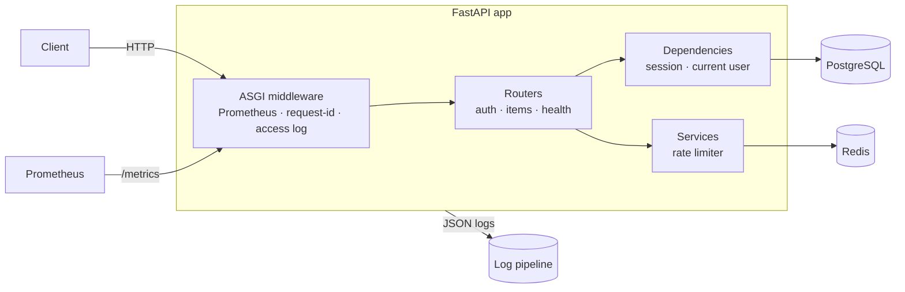
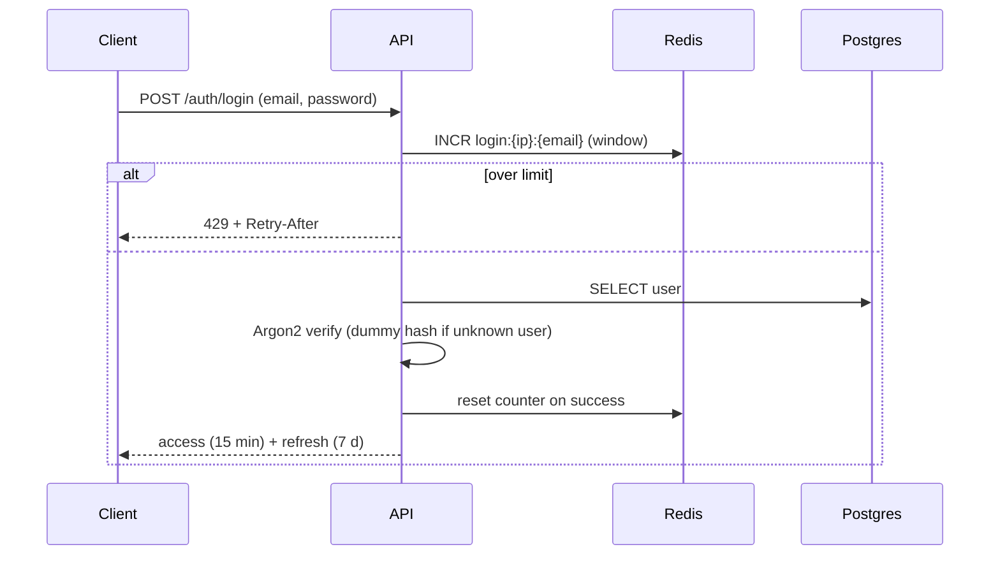

# fastapi-production-template

[](https://github.com/HOFFMAN-ALTERNATIVE/fastapi-production-template/actions/workflows/ci.yml)


A FastAPI service skeleton with the unglamorous parts already done, so a new service starts at business logic: migrations that roll back, auth that resists brute force, queryable JSON logs, metrics with bounded label cardinality, health checks orchestrators understand, and a non-root container. Type-checked with `mypy --strict`, tested against real Postgres and Redis in CI with an 85 % coverage gate, and the migration chain is checked up, down and up again on every commit.

The trade-off: it is opinionated (Postgres, Redis, JWT, Alembic). Swapping any of those is possible but means touching several layers, and for a tiny internal tool it is more structure than you need.

## Features

| Area | Implementation |
|---|---|
| API | FastAPI, versioned `/api/v1`, Pydantic v2 schemas, generic `Page[T]` pagination |
| Database | SQLAlchemy 2 async + asyncpg, typed `Mapped[]` models, naming conventions, `TimestampMixin` |
| Migrations | Alembic (async env), CI checks `upgrade → downgrade → upgrade` and `alembic check` for drift |
| Auth | JWT access + refresh tokens (typed, with `jti`), Argon2id hashing, user-enumeration-resistant login |
| Abuse protection | Redis fixed-window login rate limiting with `Retry-After`; staging and production refuse to start with a placeholder or short JWT secret |
| Authorization | per-owner resource isolation (others' items return 404, not 403) |
| Observability | structlog JSON logs with request-id correlation, Prometheus metrics via pure-ASGI middleware with route-template labels |
| Health | `/health/live` (process) and `/health/ready` (DB + Redis, 503 when degraded) |
| Container | multi-stage build, non-root UID 10001, healthcheck with timeout, graceful shutdown (20 s), migrations on start |
| Quality | ruff (lint + format, incl. bandit rules), mypy strict, pytest + coverage gate ≥ 85% |

## Quick start

```bash
git clone https://github.com/HOFFMAN-ALTERNATIVE/fastapi-production-template.git && cd fastapi-production-template
cp .env.example .env    # set JWT_SECRET
docker compose up -d --build
open http://127.0.0.1:8000/docs
```

```bash
curl -X POST localhost:8000/api/v1/auth/register -H 'content-type: application/json' \
  -d '{"email":"ada@example.com","password":"correct-horse-1"}'
TOKEN=$(curl -s -X POST localhost:8000/api/v1/auth/login -d 'username=ada@example.com&password=correct-horse-1' | jq -r .access_token)
curl -X POST localhost:8000/api/v1/items -H "Authorization: Bearer $TOKEN" -H 'content-type: application/json' -d '{"title":"hello"}'
curl localhost:8000/metrics | grep http_requests_total
```

### Local development

```bash
python -m venv .venv && . .venv/bin/activate
pip install -e ".[dev]"
pytest                     # SQLite + fakeredis, no services needed
ruff check . && ruff format --check . && mypy app tests
alembic revision --autogenerate -m "add table"   # new migration
```

## Architecture





## Layout

```
app/
  core/       config, logging, security (JWT, Argon2), metrics, middleware
  db/         declarative base, async engine/session
  models/     SQLAlchemy models
  schemas/    Pydantic models
  services/   redis client, rate limiter
  api/        deps + routes (auth, items, health)
alembic/      async migration env + versions
tests/        API, auth, isolation, platform, rate-limit tests
```

## Configuration

All settings come from environment / `.env` (see [`.env.example`](.env.example)), validated by `pydantic-settings`.
`/docs` is disabled when `ENVIRONMENT=production`.

## Limits

- Migrations run on container start. With several replicas starting at once, run `alembic upgrade head` as a separate one-off job instead.
- Fixed-window rate limiting allows up to twice the limit across a window boundary. Good enough for login abuse, not for billing.
- Refresh tokens are not stored server-side, so they cannot be revoked individually before expiry; keep their TTL short or add a deny-list.
- HS256 with one shared secret. Use asymmetric keys if other services must verify tokens.

Security notes: [SECURITY.md](SECURITY.md).

## Container image

Multi-arch (amd64/arm64) images are published to GitHub Container Registry on every release:

```bash
docker pull ghcr.io/hoffman-alternative/fastapi-production-template:latest
```

## License

MIT, see [LICENSE](LICENSE).
